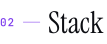
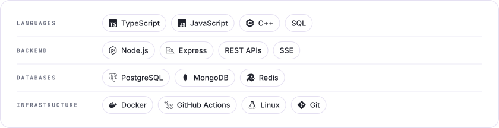
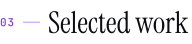
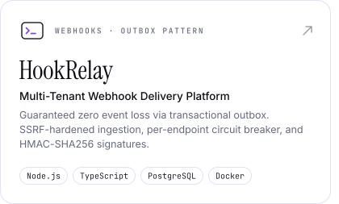
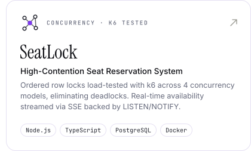
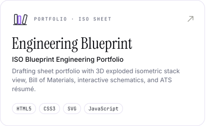
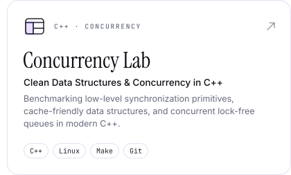
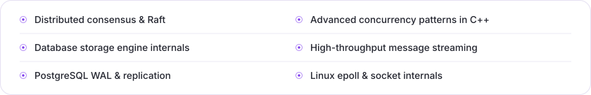

<!-- Generated by build.py: edit CONTENT there, then run `python3 build.py`. -->

<a href="https://nitishchauhan.dev"><picture><source media="(prefers-color-scheme: dark)" srcset="https://raw.githubusercontent.com/nitish9302/nitish9302/main/assets/banner-night.svg"></picture></a>

<a href="https://nitishchauhan.dev"><b>Portfolio</b></a> &nbsp;·&nbsp; <a href="https://www.linkedin.com/in/nitishchauhan13/"><b>LinkedIn</b></a> &nbsp;·&nbsp; <a href="https://github.com/nitish9302/pgqueue"><b>PgQueue</b></a> &nbsp;·&nbsp; <a href="https://github.com/nitish9302/hookrelay"><b>HookRelay</b></a> &nbsp;·&nbsp; <a href="https://github.com/nitish9302/seatlock"><b>SeatLock</b></a>

 

<picture><source media="(prefers-color-scheme: dark)" srcset="https://raw.githubusercontent.com/nitish9302/nitish9302/main/assets/section-1-night.svg"></picture>

- **Now** — Backend systems engineer building reliable, concurrency-safe infrastructure with **Node.js, TypeScript, and PostgreSQL**.
- **Focus** — Zero-loss transactional pipelines, lease-based crash recovery, row-level locking concurrency, and EXPLAIN ANALYZE index tuning.
- **Systems** — Shipped **[PgQueue](https://github.com/nitish9302/pgqueue)** (FOR UPDATE SKIP LOCKED queue), **[HookRelay](https://github.com/nitish9302/hookrelay)** (zero-loss webhook delivery via Transactional Outbox), and **[SeatLock](https://github.com/nitish9302/seatlock)** (high-contention seat holds with ordered row locks).
- **Studying** — Finishing **B.Tech in Computer Science** (2022 — 2026) at Graphic Era Hill University.

 

<picture><source media="(prefers-color-scheme: dark)" srcset="https://raw.githubusercontent.com/nitish9302/nitish9302/main/assets/section-2-night.svg"></picture>

<picture><source media="(prefers-color-scheme: dark)" srcset="https://raw.githubusercontent.com/nitish9302/nitish9302/main/assets/stack-night.svg"></picture>

 

<picture><source media="(prefers-color-scheme: dark)" srcset="https://raw.githubusercontent.com/nitish9302/nitish9302/main/assets/section-3-night.svg"></picture>

<a href="https://github.com/nitish9302/pgqueue"><picture><source media="(prefers-color-scheme: dark)" srcset="https://raw.githubusercontent.com/nitish9302/nitish9302/main/assets/featured-night.svg"></picture></a>

<a href="https://github.com/nitish9302/hookrelay"><picture><source media="(prefers-color-scheme: dark)" srcset="https://raw.githubusercontent.com/nitish9302/nitish9302/main/assets/project-hookrelay-night.svg"></picture></a><a href="https://github.com/nitish9302/seatlock"><picture><source media="(prefers-color-scheme: dark)" srcset="https://raw.githubusercontent.com/nitish9302/nitish9302/main/assets/project-seatlock-night.svg"></picture></a>

<a href="https://nitishchauhan.dev"><picture><source media="(prefers-color-scheme: dark)" srcset="https://raw.githubusercontent.com/nitish9302/nitish9302/main/assets/project-engineering-blueprint-night.svg"></picture></a><a href="https://github.com/nitish9302"><picture><source media="(prefers-color-scheme: dark)" srcset="https://raw.githubusercontent.com/nitish9302/nitish9302/main/assets/project-concurrency-lab-night.svg"></picture></a>

 

<picture><source media="(prefers-color-scheme: dark)" srcset="https://raw.githubusercontent.com/nitish9302/nitish9302/main/assets/section-4-night.svg"></picture>

<picture><source media="(prefers-color-scheme: dark)" srcset="https://github-readme-stats.vercel.app/api?username=nitish9302&amp;show_icons=true&amp;card_width=495&amp;line_height=24&amp;custom_title=GitHub%20stats&amp;bg_color=121316&amp;border_color=242731&amp;title_color=ffffff&amp;text_color=9ea5b6&amp;icon_color=e6194b&amp;ring_color=e6194b&amp;border_radius=16"></picture> <picture><source media="(prefers-color-scheme: dark)" srcset="https://github-readme-stats.vercel.app/api/top-langs/?username=nitish9302&amp;layout=compact&amp;langs_count=8&amp;card_width=495&amp;custom_title=Most%20used%20languages&amp;bg_color=121316&amp;border_color=242731&amp;title_color=ffffff&amp;text_color=9ea5b6&amp;icon_color=e6194b&amp;ring_color=e6194b&amp;border_radius=16"></picture>

<picture><source media="(prefers-color-scheme: dark)" srcset="https://streak-stats.demolab.com/?user=nitish9302&amp;card_width=1010&amp;background=121316&amp;border=242731&amp;stroke=242731&amp;ring=e6194b&amp;fire=e6194b&amp;currStreakNum=ffffff&amp;sideNums=ffffff&amp;currStreakLabel=e6194b&amp;sideLabels=9ea5b6&amp;dates=5e6974&amp;border_radius=16"></picture>

 

<picture><source media="(prefers-color-scheme: dark)" srcset="https://raw.githubusercontent.com/nitish9302/nitish9302/main/assets/section-5-night.svg"></picture>

<picture><source media="(prefers-color-scheme: dark)" srcset="https://raw.githubusercontent.com/nitish9302/nitish9302/main/assets/learning-night.svg"></picture>

 

<picture><source media="(prefers-color-scheme: dark)" srcset="https://raw.githubusercontent.com/nitish9302/nitish9302/main/assets/section-6-night.svg"></picture>

<a href="https://nitishchauhan.dev"><picture><source media="(prefers-color-scheme: dark)" srcset="https://raw.githubusercontent.com/nitish9302/nitish9302/main/assets/button-portfolio-night.svg"></picture></a>&nbsp;&nbsp;<a href="https://www.linkedin.com/in/nitishchauhan13/"><picture><source media="(prefers-color-scheme: dark)" srcset="https://raw.githubusercontent.com/nitish9302/nitish9302/main/assets/button-linkedin-night.svg"></picture></a>

<picture><source media="(prefers-color-scheme: dark)" srcset="https://raw.githubusercontent.com/nitish9302/nitish9302/main/assets/footer-night.svg"></picture>
